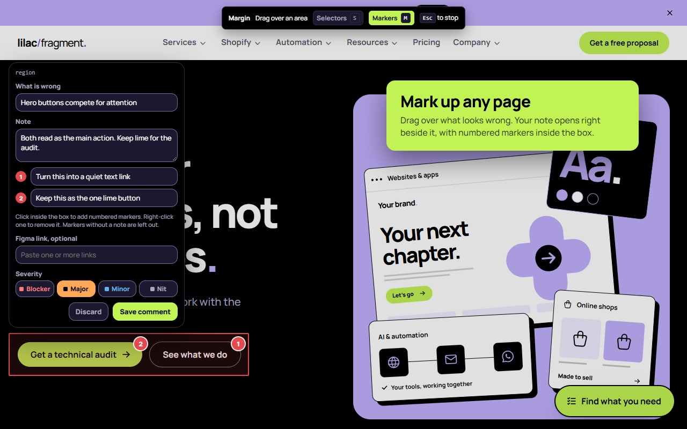

# Margin

Mark up UI issues on any web page, number the details, and hand over a clean review in Google Docs, Word, HTML or PDF.

Margin is a Chrome extension by [Lilac Fragment](https://lilacfragment.co.za/margin/).

## Install

Get it from the [Chrome Web Store](https://chromewebstore.google.com/detail/ldhompocjnoloimngcpdlmfillfenmfa).

To run it from source, open `chrome://extensions`, turn on Developer mode, click Load unpacked and pick the `extension` folder.

## How it works

1. Click the Margin icon or press Alt+Shift+A on any page.
2. Drag over what looks wrong and write a note. Click inside the box to add numbered markers.
3. Open the review report and copy it into Google Docs, or export Word, HTML or PDF.

No account, no server and no tracking. Everything stays in your browser. Read the [privacy policy](https://lilacfragment.co.za/margin/privacy/).

## Roadmap

1. Jira integration
2. Syncing tasks
3. Workspaces and shared reviews
4. Agent handoff

## Development

Plain JavaScript modules with no build step. `npm run package` builds the team zip and the Chrome Web Store zip into `dist`.

## License

[MIT](LICENSE)
